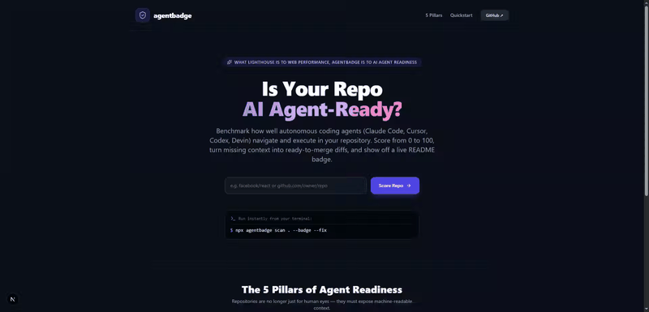

<div align="center">

# 🛡️ agentbadge
### *What Lighthouse is to web performance, agentbadge is to AI agent readiness.*

[](https://github.com/Emreceyhnn/Agentbadge)
[](https://github.com/Emreceyhnn/Agentbadge/actions)
[](https://www.typescriptlang.org/)
[](LICENSE)

<br />

**Scores how well a repository can be worked on by AI coding agents (Claude Code, Cursor, Codex, Devin, Copilot) from 0 to 100, and provides a live dynamic badge for your README.**

<br />

[Quickstart](#-quickstart) • [The 5 Pillars](#-the-5-pillars-100-points-total) • [One-Click Remediation](#-one-click-remediation) • [Dynamic Badges](#-live-svg-badge-integration) • [Contributing](#-contributing)

<br />



</div>

---

## 💡 The Problem: Repositories Were Engineered for Humans

When a new human engineer joins your team, they get the README, the setup guide, and twenty minutes looking over a teammate's shoulder. 

When an **autonomous AI coding agent** enters your repository, it gets raw files.
- It **guesses** the bootstrap and install commands.
- It **invents tests** where none exist.
- It has no clue **why** the backend depends on Redis.
- It repeats the same architectural mistake three times, and engineers dismiss the model as incapable.

> **It is not a model limitation. It is a context failure.**  
> Repositories do not expose what an agent needs in a machine-readable format.

---

## ⚡ The Solution: agentbadge

`agentbadge` statically audits your codebase across 5 core pillars, calculates a deterministic 0–100 readiness score, generates a live SVG badge, and outputs a ready-to-merge remediation PR/diff.

```
┌────────────────────────────────────────────────────────────────────────┐
│                        AGENT READINESS SCORE: 100                      │
├──────────────┬──────────────┬──────────────┬─────────────┬─────────────┤
│ 1. CONTEXT   │   2. SETUP   │3.VERIFICATION│ 4.GUARDRAIL │  5. TOOLING │
│   (25 Pts)   │   (20 Pts)   │   (20 Pts)   │   (20 Pts)  │   (15 Pts)  │
└──────────────┴──────────────┴──────────────┴─────────────┴─────────────┘
```

### Readiness Tiers
- 🟢 **80 – 100**: `agent-ready` (A / A+)
- 🔵 **60 – 79**: `agent-friendly` (B)
- 🟡 **40 – 59**: `agent-tolerated` (C)
- 🔴 **0 – 39**: `agent-hostile` (F)

---

## 🚀 Quickstart

Run a scan in any repository in under 5 seconds:

```bash
# 1. Run full audit in current directory
npx agentbadge scan .

# 2. Export live SVG badge directly to your repository
npx agentbadge scan . --badge

# 3. Auto-generate recommended AGENTS.md instructions (safe & idempotent)
npx agentbadge scan . --fix

# 4. Output machine-readable JSON for CI/CD gates
npx agentbadge scan . --json
```

### Terminal Output Preview:
```text
🛡️  agentbadge — Repository Readiness Scanner

Repository: Agentbadge
Overall Score: 86/100 (A) · agent-ready

Pillar Breakdown:
────────────────────────────────────────────────────────────
Context & Documentation      ████████████████████ 100% (25/25 pts)
Setup & Environment          ████████████████████ 100% (20/20 pts)
Verification & Testing       ████████████████████ 100% (20/20 pts)
Guardrails & Safety          ███████████████░░░░░  75% (15/20 pts)
Tooling & Schemas            ████████░░░░░░░░░░░░  40% (6/15 pts)
────────────────────────────────────────────────────────────
```

---

## 🏛️ The 5 Pillars (100 Points Total)

### 1. Context & Boundaries (25 Points)
*Does the agent understand project boundaries within the first 60 seconds?*
- `AGENTS.md` / `CLAUDE.md` / `.cursorrules` guidelines (+10)
- Architecture overview, directory map & design principles in `README.md` (+8)
- Architecture Decision Records (ADRs) or structured `docs/` index (+4)
- `CONTRIBUTING.md` defining branch conventions and PR criteria (+3)

### 2. Setup & Environment (20 Points)
*Can the agent spin up the project without guessing system dependencies?*
- Deterministic package lockfiles (`pnpm-lock.yaml`, `package-lock.json`, `poetry.lock`, `Cargo.lock`) (+6)
- Comprehensive `.env.example` template for secrets and runtime configuration (+5)
- Container or sandbox specifications (`Dockerfile`, `docker-compose.yml`, `.devcontainer`) (+5)
- Single-command bootstrap script (`Makefile`, `Taskfile`, `npm run setup`) (+4)

### 3. Verification & Feedback Loops (20 Points)
*Can the agent verify its changes in under 30 seconds?*
- Executable automated test suite command (`npm test`, `pytest`, `cargo test`) (+8)
- Strict static type checking (`tsc --noEmit`, `mypy --strict`) (+6)
- Linter and formatter configurations (`biome`, `eslint`, `ruff`) (+6)

### 4. Guardrails & Safety (20 Points)
*Are there automated barriers preventing regressions and secret leakage?*
- Automated CI/CD pipeline on push/PR (`.github/workflows`) (+10)
- Pre-commit git hooks (`husky`, `lefthook`, `pre-commit`) (+5)
- Secret leakage prevention and strict `.gitignore` rules (+5)

### 5. Tooling & Machine Readability (15 Points)
*Can the agent execute structured CLI tools and consume machine-readable contracts?*
- Automation scripts directory (`scripts/`, project CLI utilities) (+6)
- Model Context Protocol (MCP) server manifest (`mcp.json`) (+5)
- Declarative data schemas (`OpenAPI`, `GraphQL`, `Prisma`, `Protobuf`) (+4)

---

## 🛠️ One-Click Remediation

Don't just diagnose — **fix**.

When you run `npx agentbadge scan . --fix`, `agentbadge` analyzes the exact deficiencies and safely patches your **`AGENTS.md`** file:
- **Idempotent**: Re-running `--fix` never creates duplicate sections.
- **Context-Aware**: Detects your package manager (`pnpm`, `npm`, `yarn`, `bun`) and adjusts verification commands accordingly.

---

## 🌐 Live SVG Badge Integration

Embed your live repository badge in your `README.md`:

```markdown
[](https://github.com/Emreceyhnn/Agentbadge)
```

Generated sample badge:

<div align="center">
  
</div>

---

## 👥 Contributing

Contributions are warmly welcome! Whether you are adding new framework detectors or improving heuristics:

1. Fork the repository.
2. Clone locally: `git clone https://github.com/Emreceyhnn/Agentbadge.git`
3. Install dependencies: `pnpm install`
4. Build & verify: `pnpm run build && pnpm run test`
5. Open a Pull Request!

---

<div align="center">
  <b>Star ⭐ this repository if you believe AI coding agents deserve better context!</b><br />
  <sub>Built with ❤️ for the future of autonomous software engineering.</sub>
</div>
